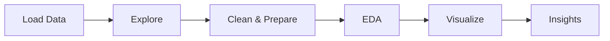

<h1 align="center">📊 Superstore Sales Analysis</h1>

<p align="center">
  
  
  
  
  
</p>

<p align="center">
  <b>Sales, customers, regions aur shipping patterns ko samajhne ke liye ek hands-on Python EDA project.</b>
</p>

<p align="center">
  <a href="#-quick-stats">Stats</a> •
  <a href="#-key-findings">Findings</a> •
  <a href="#-project-details">Details</a> •
  <a href="#-sample-code">Code</a> •
  <a href="#-how-to-run">Run</a> •
  <a href="#-author">Author</a>
</p>

---

## ⚡ Quick Stats

| 📦 Records | 🧾 Columns | 👥 Customers | 🗂️ Categories | 🏷️ Sub-categories | 📆 Period |
|:---:|:---:|:---:|:---:|:---:|:---:|
| **9,800** | **18** | **793** | **3** | **17** | **2015–2018** |

---

## 💡 Key Findings

| 🔎 Metric | 📌 Result |
|---|---|
| 💰 Total Sales | ~2.26 million |
| 🌍 Top Region | **West** (~710,219.68) |
| 🖥️ Top Category | **Technology** (~827,455.87) |
| 📱 Top Sub-Category | **Phones** (~327,782.45) |
| 👤 Top Customer | **Sean Miller** (~25,043.05) |
| 📅 Best Year | **2018** (~722,052.02) |
| 🗓️ Best Month | **November** (~350,161.71) |
| 🚚 Shipping | Standard Class slowest (~5 days), Same Day fastest |

> ℹ️ Yeh findings data ke patterns batati hain, unke causes nahi.

---

## 🧭 Project Details

> 👇 Section kholne ke liye click karein

<details>
<summary>🎯 <b>Objectives</b></summary>

- Dataset ko explore aur clean karna
- Region, category aur sub-category wise sales analyze karna
- Top customers aur products identify karna
- Monthly aur yearly trends samajhna
- Ship modes ka shipping time compare karna
- Charts se findings communicate karna

</details>

<details>
<summary>🧹 <b>Data Cleaning & Preparation</b></summary>

- `Postal Code` mein 11 missing values mile
- Duplicate rows: none found
- `Order Date` aur `Ship Date` ko datetime mein convert kiya
- New columns: order month, order year, shipping time (days)

> ⚠️ Missing postal codes identify kiye gaye hain, lekin abhi imputation/removal nahi hua.

</details>

<details>
<summary>🔍 <b>Analysis Covered</b></summary>

| Area | What I Did |
|---|---|
| 💰 Sales | Region, category, sub-category wise comparison |
| 👤 Customers | Top 5 customers, order counts |
| 📅 Time | Monthly aur yearly trends |
| 🚚 Shipping | Ship mode wise average time aur order counts |

</details>

<details>
<summary>📈 <b>Visualizations Used</b></summary>

Bar chart · Line chart · Histogram · Count plot · Box plot · Heatmap · Scatter plot

</details>

<details>
<summary>📋 <b>Important Columns</b></summary>

`Order ID` · `Order Date` · `Ship Date` · `Customer Name` · `Segment` · `Region` · `Category` · `Sub-Category` · `Sales` · `Ship Mode`

</details>

<details>
<summary>🔄 <b>Workflow</b></summary>



</details>

---

## 🧪 Sample Code

<details>
<summary>🐼 <b>Dates convert karna aur shipping time nikalna</b></summary>

```python
df["Order Date"] = pd.to_datetime(df["Order Date"])
df["Ship Date"] = pd.to_datetime(df["Ship Date"])
df["Shipping Days"] = (df["Ship Date"] - df["Order Date"]).dt.days
```

</details>

<details>
<summary>🌍 <b>Region wise total sales</b></summary>

```python
df.groupby("Region")["Sales"].sum().sort_values(ascending=False)
```

</details>

<details>
<summary>👤 <b>Top 5 customers</b></summary>

```python
df.groupby("Customer Name")["Sales"].sum().nlargest(5)
```

</details>

---

## 🛠️ Tech Stack

| Tool | Use |
|---|---|
| 🐍 Python | Core analysis |
| 🐼 Pandas | Cleaning & aggregation |
| 🔢 NumPy | Numerical operations |
| 📊 Matplotlib | Charts |
| 🎨 Seaborn | Statistical plots |
| 📓 Jupyter | Interactive notebook |

---

## 📚 What I Learned

- [x] Pandas se CSV load aur explore karna
- [x] Missing values aur duplicates check karna
- [x] Datetime columns se features nikalna
- [x] `groupby()`, `sum()`, `mean()`, `idxmax()` ka use
- [x] Matplotlib & Seaborn se visualizations banana
- [x] Charts ko insights mein badalna

---

## ▶️ How to Run

```bash
git clone YOUR_REPOSITORY_URL
cd YOUR_PROJECT_FOLDER
pip install pandas numpy matplotlib seaborn jupyter
jupyter notebook
```

> 📁 Dataset ko project folder mein rakhein aur notebook mein CSV path update karein.

---

## 🚀 Roadmap

- [x] Data exploration & cleaning
- [x] EDA & visualizations
- [x] Missing value handling
- [ ] Deeper time-series analysis
- [ ] Customer segment aur regional pattern analysis
- [ ] Interactive dashboard (Power BI / Tableau)

---

## 👨‍💻 Author

**Aman Kumar** — B.Tech CS student, learning Data Analysis one dataset at a time.

[](https://github.com/aman13-oss)

<p align="center">⭐ Agar project pasand aaya to star zaroor karein!</p>
